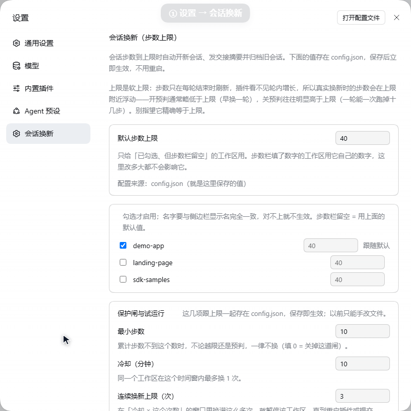

# 推广材料（不进 Pages，仅仓库内部用）

本文件是发布/推广用的素材草稿：release notes 正文、演示 GIF 的录制与压制步骤、发帖用短文案。
改完这里的内容再手动贴到 GitHub / 社区，不要直接把本文件当文档发出去。

---

## 一、v1.0.0 Release Notes（已发布，这里只留底）

> 线上正文就是下面代码块里这段（https://github.com/cry-flu/dsh-session-rotate/releases/tag/v1.0.0 ），它是 v1.0.0 当时的快照，别拿现在的数字回填历史版本：其中 `npm test` 写的是当时的 23 pass，仓库现在跑出来是 46 pass。
> 一字不差的例外只有一处：代码块里 `npm test → 23 pass / 0 fail` 那句末尾括号里的 `（v1.0.0 当时的数字）` 是仓库里加的注解（14 个字符），线上正文没有它。2026-11-08 用 `api.github.com` 取 v1.0.0 正文比对过：块 2381 字符 / 线上 2367 字符，差异正好是这 14 个字符。
> 新的版本号一律用 `tools\release.ps1` + `release-notes-v<版本>.md` 发，不再改这一节。

```markdown
长会话越滚越贵。步数到上限时，这个插件在**这一轮答完之后**（绝不中途打断）自动开新会话、把一份本地拼出来的交接摘要投过去、归档旧会话，再把界面切到新会话。摘要不调用模型，是纯本地模板拼装——省下的是「手动总结 + 复制 + 新建会话 + 记住进度」这四步。

### 它解决什么

- **省钱但不额外花钱**：交接摘要由本地模板生成（取最近用户消息 + 最后一条回复，最多 16 行），零模型调用。真正计费的只有新会话的第一轮请求。
- **不打断**：只在轮与轮之间判定，正在跑的轮一定跑完。上限是**软上限**，换新点会在 `maxSteps` 附近浮动。
- **可先空跑验证**：`dryRun` 只写日志、不建会话、不归档、不跳转。
- **不会连环换**：`minSteps` 硬下限 + `cooldownMinutes` 冷却 + `maxRotations` 连续触发后自动暂停该工作区（状态持久化在 `state.json`，重启不清零）。

### 安装（四步）

1. profile 的 `package.json` 里登记依赖和 bundle：
   ```json
   {
     "dependencies": { "dsh-session-rotate": "github:cry-flu/dsh-session-rotate" },
     "dsh": { "profile": { "bundles": ["...", "dsh-session-rotate"] } }
   }
   ```
2. 让 `node_modules` 里有这个名字（跑包管理器 install，或 `cmd /c mklink /J "<profile>\node_modules\dsh-session-rotate" "<插件目录绝对路径>"`）。
3. 在 profile 的 `cordis.patch.yml` 末尾挂载：
   ```yaml
   - insert:
       - id: dsh-session-rotate
         name: dsh-session-rotate
         config:
           defaultMaxSteps: 40
           workspaces:
             - name: my-workspace      # 与侧边栏显示名完全一致
               maxSteps: null          # null / 省略 / 0 / "" = 跟随 defaultMaxSteps
   ```
   `workspaces` 为空数组 = 所有工作区都不生效，用哪个就加哪一行。
4. **整个 DSH 换进程重启一次**。「重开窗口」不会重载插件；重启后 Web GUI 端口会变。

### 先空跑确认再真用

把要测的工作区加进 `workspaces`（`maxSteps` 填你真实在用的值），打开 `dryRun`，正常干活跨过那个步数，然后看 `~/.dsh/session-rotate/debug.log`：命中会记一条 `[dry-run] 只记日志不换`（同一会话同一档步数只记一次）。

别把 `maxSteps` 调成 2、3 去真测——换新是真的换，一晚上能刷出一屏空会话。

### 已知限制（先说清楚）

- **热重载无效**：改插件代码（尤其 `lib/client.js`）后必须整个 DSH 换进程重启。
- **上限是软上限**：判定只在轮间发生，开预判通常略早，关预判可能明显偏高（一轮能跑掉二十几步）。
- **新会话第一轮照常计费**：摘要本身零成本，但那一轮请求是真的。
- 只对顶层会话生效，子会话跳过；每个会话只触发一次。

### 兼容性

只在我本人环境验证过：DSH 桌面版 `0.2.1-rc.3`（Windows）+ Node `v24.18.0`，`npm test` → 23 pass / 0 fail（v1.0.0 当时的数字）。CI 在 ubuntu + windows × node 20/22/24 跑单测，但**不覆盖宿主行为**，其他环境请先小范围试用。

### 注意

**不在 npm 上。** 包名 `dsh-session-rotate` 在 npm 上属于另一位作者的同名插件，不是本项目。

大部分代码由 AI 辅助生成，经人工审查与本地测试，但不保证所有环境行为如预期。有问题请开 issue，最想要的是「你的环境里到底能不能正常触发」。

---

## v1.0.0 相对 0.2.1 的变更

### 版本变更清单

- 版本号 `0.2.1` → `1.0.0`；`engines.node` 声明 `>=20`。
- `npm test` 改为 `node --test`：自动发现测试文件，不依赖 shell 展开 glob，Node 20 / 22 / 24 都能跑。
- `package.json` 补齐 `repository` / `bugs` / `homepage` / `author`。
- README：删除全部本机绝对路径，安装步骤改为 `github:OWNER/REPO`；补充「改完代码怎么让它真正加载」。
- 新增 `.github/workflows/test.yml`：Ubuntu / Windows × Node 20 / 22 / 24 跑单测。

### 已知限制

上限是软上限，真实换新点会在 `maxSteps` 附近浮动。
```

---

## 二、演示 GIF：录什么 + 怎么压

### 录什么（仓库里现在这条：约 18 秒，6 个镜头）

按顺序讲「先留 N 分钟 → 到点先切走再归档」这条链路（1.4.0 起），全程只在设置页里点：

| 约秒 | 画面 | 目的 |
| --- | --- | --- |
| 0–3 | 打开设置 → 左栏「会话换新」，露默认步数上限与工作区名单，随后平滑滚到开关区 | 交代入口 |
| 3–6 | 取消勾选「换新后自动跳到新会话」 | 引出下一项 |
| 6–7.8 | 面板里冒出「归档到点时自动跳到新会话」且已勾上 | 1.4.0 的新开关 |
| 7.8–11.9 | 「归档前先留」填 1，再滚到底部 | 保留窗口怎么开 |
| 11.9–15.1 | 点「保存」，按钮旁出现「已保存」 | 保存即生效、不用重启 |
| 15.1–17.9 | 停在「最近日志」，读到写入行 | 落盘证据 |

输出是 800×800（在 1200×900 视口里裁 `200,50,800,800`），实测 **17.87 秒 / 227 帧 / 0.75 MB / 12.7 fps**。

每个镜头的准确时间点记在 `docs\img\demo.timeline.json`（`shots[].frame` 与 `shots[].seconds`，秒数 = 帧号 ÷ 实测 fps），表里的秒数可以据此复算，不用去数 GIF。

**脚本分镜与这条 GIF 完全对应**：`tools\record-cdp.cjs` 里就是上表这 6 个镜头（`window.__cap` 的六条文案一一对应），初态由 `resetConfig()` 写成 `deferArchiveMinutes: 1`，所以取消「换新后自动跳到新会话」时「归档到点时自动跳到新会话」会立刻冒出来（1.4.1 起该行的显示条件是 `autoSwitch || !(deferArchiveMinutes > 0)`，初态为 0 就不会出现）。每次点击前先 `scrollIntoView` 把目标滚进视口——面板比视口高，滚出视口的元素收不到 CDP 的鼠标事件，会静默不生效。

录制要点：**只录窗口区域**、不要录到自己的 key/路径/其他会话标题、别用鼠标画圈（GIF 里会糊）。走路线 A 时这些都由脚本兜住（视口 1200×900 定死、假工作区名、假光标带点击涟漪、顶部字幕条）。

素材里一定会出现的 7 类敏感区（发图前对着核一遍）：标题栏用户名、左侧会话标题列表、对话正文/思考块/模型名、底部状态栏的 token 数与缓存命中、设置页的工作区名单、「最近日志」里的 `C:\Users\<你>\.dsh\...` 与 session UUID、「打开配置文件」旁的路径。

### 路线 A：仓库自带录制脚本（推荐，全自动、不上屏）

`tools\record-cdp.ps1` 起一个**独立的临时 DSH_HOME + 无头 Chrome**，用 CDP 截页面，不碰你的屏幕：屏幕上开着什么窗口都录不进去，演示用的工作区是脚本自己造的假名字（`demo-app` / `landing-page` / `sdk-samples`），画面里出现的路径是临时 HOME 下的中性路径（脚本默认 `C:\ProgramData\dsh-rotate-demo-home\...`，仓库里这条 GIF 录的就是它），没有用户名、没有你的仓库路径。

```powershell
cd 'D:\dsh-plugins\dsh-session-rotate'
pwsh -NoProfile -File .\tools\record-cdp.ps1
# 产出 docs\img\demo.gif 和 docs\img\demo.timeline.json（后者记 6 个镜头的帧号/秒数）
```

- 需要：Node 22+（用内置 WebSocket，不用 `npm install`）、ffmpeg、Chrome 或 Edge、`dsh` 在 PATH 上。
- 第一次跑会往那个临时 HOME 装一次插件（走网络）；装不了或已装好可以加 `-SkipPluginInstall`，另用 `-PluginRef <npm 或 github 地址>` 换来源。
- 常用参数：`-Out docs\img\demo.gif -Port 3399 -CdpPort 9222 -Fps 14`；想留中间帧/调色板加 `-Keep`；Chrome、ffmpeg 位置特殊时用 `-Chrome` / `-Ffmpeg`。
- 想复用自己的干净 HOME：`-DshHome D:\tmp\demo-home`。**不要指向日常的 `~/.dsh`**，否则真实工作区名和配置路径会被录进画面。
- 插件没装上、或装上了没挂载（页面上根本没有「会话换新」这一栏）时，脚本会直接报错退出并打印日志尾部，不会录出一张废片。

### 路线 B：录真实界面（GDI 抓屏，谨慎）

`tools\record-demo.ps1` 抓窗口客户区 → ffmpeg 两遍调色板压成 GIF（自动压到 ≤3 MB）。

```powershell
cd 'D:\dsh-plugins\dsh-session-rotate'
pwsh -NoProfile -File .\tools\record-demo.ps1 -WindowTitle 'DeepSeek Harness' -Seconds 30 -StartDelay 8
```

**它录的是你屏幕上的像素**：任何盖在目标窗口上的窗口都会被一起录进去——包括左边栏的会话标题、设置页里的工作区真名、日志面板里的 `C:\Users\<你>\...` 和 session UUID。往 public 仓库发图请用路线 A；非要用这条，先关掉所有会重叠的窗口，录完**逐帧看一遍**再压。

- 用 `-WindowTitle` 锁窗口（不传就录跑脚本那一刻的前台窗口）；录的是**窗口客户区**，不带任务栏。
- ffmpeg 自动在 PATH 和 `D:\tools\ffmpeg\bin` 等处找；找不到用 `-Ffmpeg <路径>`。
- 超 3 MB 会自动降到 10/8/6 fps 或 900/800/700 px 重压；仍超就 `-Seconds` 调短。
- 想留原始帧复查：加 `-KeepFrames`（会打印帧目录，默认录完删掉）。

### 路线 B2：带自动分镜的抓屏（`tools\record-storyboard.ps1`）

同样 GDI 抓屏，但带 UIA 自动分镜（点头像 → 设置 → 会话换新 → 面板滚动 → Esc 关闭，默认 16 秒 / 10 fps），输出同样是 `docs\img\demo.gif`，`-NoActions` 只录不操作。它录的是真窗口，脱敏要求同路线 B。

### 路线 C：ScreenToGif（GUI，想手改帧时用）

1. 装 [ScreenToGif](https://www.screentogif.com/)（开源，绿色版可用）。
2. Recorder → 框选窗口 → 15 fps 录制。
3. 录完在编辑器里删掉多余帧（这一步是压体积的关键），另存为 GIF。
4. 目标：**≤ 3 MB**。超了就删帧、或把宽度降到 1000px。

### 路线 D：先录 mp4 再压（OBS / Win+G）

ffmpeg 本机已有：`D:\tools\ffmpeg\bin\ffmpeg.exe`（9.0.2，只是不在 PATH 里）。

录 mp4（`Win+G` Xbox Game Bar，或 OBS 只录窗口），存成 `demo.mp4`，然后两遍调色板压制（第二遍才出高质量小体积 GIF）：

```powershell
cd 'D:\dsh-plugins\dsh-session-rotate'
$ff = 'D:\tools\ffmpeg\bin\ffmpeg.exe'
& $ff -y -i demo.mp4 -vf "fps=12,scale=1000:-1:flags=lanczos,palettegen=stats_mode=diff" palette.png
& $ff -y -i demo.mp4 -i palette.png -lavfi "fps=12,scale=1000:-1:flags=lanczos[x];[x][1:v]paletteuse=dither=bayer:bayer_scale=5:diff_mode=rectangle" -loop 0 docs\img\demo.gif
(Get-Item docs\img\demo.gif).Length / 1MB
```

体积超 3 MB 就按顺序调：`fps=12 → 10 → 8`，`scale=1000 → 900 → 800`，或者直接把 mp4 剪短。压制完删掉 `palette.png` 和 `demo.mp4`（别提交进仓库，仓库里只放 GIF）。

### 压完把 GIF 插进两份 README

中文 `README.md` 的 `## 功能` 之前插一行（与仓库现在的一致）：

```markdown

```

英文 `README.en.md` 的 `## Features` 之前插同一行，图注写英文（路径相同）：

```markdown

```

插完各跑一次检查：`git status --short` 应看到 `docs/img/demo.gif` 被修改（它已经被跟踪了，但第一次插入时会是新增）、两份 README 是修改。

---

## 三、发帖短文案（一次一句，别改写成长文）

**群里转发（一句 + 链接）**

> 分享个自己写的 DSH 插件：会话步数到上限自动换新会话，交接摘要本地拼、不调模型。只在轮末换、不打断，有 dryRun 可以先空跑验证。装的时候注意要**整个 DSH 换进程重启**（重开窗口不算）。https://github.com/cry-flu/dsh-session-rotate

**X / 推**

> Built a plugin for DeepSeek Harness: when a session hits its step limit, it rotates at the turn boundary, hands over a locally-templated summary (zero model calls), archives the old session and switches the UI. Dry-run mode first. MIT. https://github.com/cry-flu/dsh-session-rotate

**V2EX 标题候选**

- `做了个 DSH 插件：长会话到上限自动换新，交接摘要不花 token`
- `长会话越聊越贵，我写了个插件在轮末自动换新会话`

**正文骨架（正文只说这六段，别加第七段）**

1. 痛点：一个会话滚到几十步，每轮都在为历史付费（讲自己的账，不编数字）。
2. 解法：轮末换新 + 本地拼摘要 + 保护闸防连环换。
3. 怎么装：四步，**标注"必须换进程重启"**。
4. 怎么先验证：`dryRun` 步骤，四行。
5. 已知限制：软上限、只对顶层会话生效、只在自己环境测过。
6. 求什么：**求 issue，不求 star** —— 最想知道"你环境里能不能正常触发"。
