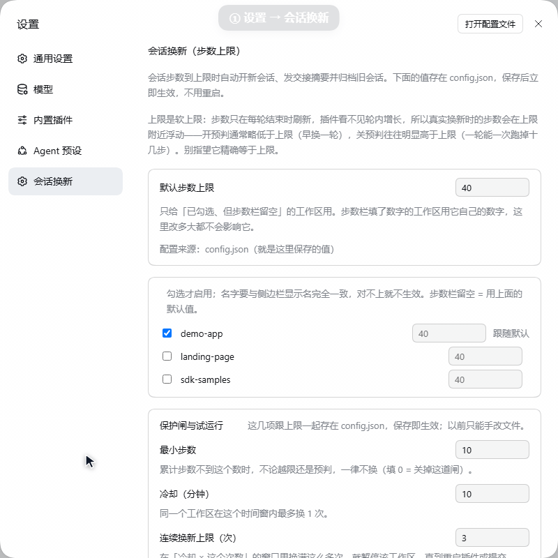
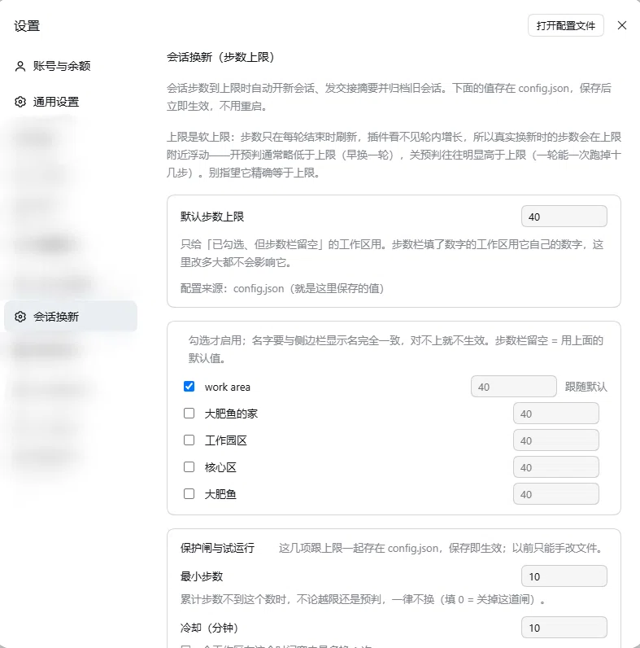

# dsh-session-rotate

English | [简体中文](README.md)

[](https://github.com/cry-flu/dsh-session-rotate/actions/workflows/test.yml)
[](https://github.com/cry-flu/dsh-session-rotate/releases)
[](LICENSE)
[](package.json)
[](https://cry-flu.github.io/dsh-session-rotate/)

Long sessions get more expensive with every turn. When a session reaches its step limit, this plugin waits until **the current turn has finished** (it never cuts a turn in half), opens a new session, hands over a handoff summary assembled locally, archives the old session, and switches the UI to the new one. The old session is archived right away by default; set `deferArchiveMinutes` to keep it in the sidebar for a few minutes so you can read its last reply first. The summary never touches a model — it is plain local templating — so what you save is the whole manual loop: summarize, copy, create a session, remember where you were.

- Runs as a profile plugin inside DeepSeek Harness (DSH) Desktop / Web GUI.
- **Not on npm.** The npm name `dsh-session-rotate` belongs to a different plugin by another author — that is not this project.



## Features

| Capability | What it does |
| --- | --- |
| Per-workspace limits | One `maxSteps` per workspace; leave it empty to inherit the global default — and keep inheriting when the default changes |
| Templated handoff summary | Fixed template: a head of at most 16 lines (latest user message plus earlier instructions), then **the full text of the last assistant reply** (up to 4000 chars, head and tail kept beyond that). **No extra model call.** The summary is delivered once, as the first user message of the new session; after that it rides along as context on every request (cache hits keep it cheap) |
| Turn-boundary prediction | Estimates the next turn from the mean of the last 3 turn deltas and rotates at the boundary instead of waiting to blow past the limit |
| Protection gates | `minSteps` hard floor, `cooldownMinutes` cooldown, `maxRotations` consecutive rotations before a workspace is paused |
| Dry run | `dryRun` only writes a log line: no session is created, nothing is archived, the UI does not jump |
| Three switches | Auto-archive (`archiveOnRotate`), deferred archive (`deferArchiveMinutes`), auto-switch (`autoSwitch`), plus "jump when the archive fires" (`switchOnArchive`). The first three combine freely; with auto-switch off, archiving only happens if `switchOnArchive` moves the UI at the deadline — turn both off and the old session is always kept |
| Only its own sessions | Archives only the old sessions this plugin rotated out, recorded in `state.json` under `ownSessions`; no enumeration, no bulk operations, other sessions are never touched |
| Control panel | Settings → 会话换新 to edit the default limit, the gates, the dry-run switch and the three toggles; saving takes effect immediately |

## Install

> **Not published on npm.** The package named `dsh-session-rotate` on npm is unrelated to this project (different author, no repository link) — do not install it with `npm i dsh-session-rotate`. Use one of the routes below: a `github:` dependency, a local `link:`, or drop it into `node_modules` manually.

**1. Register the dependency and the bundle in your profile's `package.json`** (if you already cloned the repo locally, `"link:<absolute plugin path>"` or `"file:<same>"` works instead of `github:`)

```json
{
  "dependencies": { "dsh-session-rotate": "github:cry-flu/dsh-session-rotate" },
  "dsh": { "profile": { "bundles": ["...", "dsh-session-rotate"] } }
}
```

**2. Make sure `node_modules` actually contains that name** — run your package manager's install inside the profile directory, or just create a junction:

```powershell
cmd /c mklink /J "<profile>\node_modules\dsh-session-rotate" "<absolute plugin path>"
```

**3. Mount and configure it at the end of the profile's `cordis.patch.yml`**

```yaml
- insert:
    - id: dsh-session-rotate
      name: dsh-session-rotate
      config:
        defaultMaxSteps: 40
        workspaces:
          - name: my-workspace      # must match the sidebar name exactly (spaces and case included)
            maxSteps: null          # null / omitted / 0 / "" = follow defaultMaxSteps
```

`workspaces` defaults to an empty array — **empty means the plugin does nothing anywhere**. Add one line per workspace you want it to cover.

**4. Restart the whole DSH process once.** Reopening the window does *not* reload plugins. After the restart the Web GUI port changes — take the new address from the startup log.

## Configuration

Config lives in `~/.dsh/session-rotate/config.json`; the settings page edits the same file and applies on save:

| Key | Default | Meaning |
| --- | --- | --- |
| `defaultMaxSteps` | `40` | Default step limit |
| `workspaces[]` | `[]` | `{ name, maxSteps }`; workspaces not listed here are ignored |
| `minSteps` | `10` | Do not rotate before this many cumulative steps; `0` disables the gate |
| `cooldownMinutes` | `10` | At most one rotation per workspace inside this window |
| `maxRotations` | `3` | Rotating that many times inside `cooldown × maxRotations` pauses the workspace (state lives in `state.json` and survives restarts) |
| `dryRun` | `false` | Dry-run switch |
| `archiveOnRotate` | `true` | Archive the old session on rotation; `false` keeps it in the sidebar — clean it up yourself when you no longer need it (the last reply is still pasted in full into the handoff) |
| `deferArchiveMinutes` | `0` | How long the old session stays unarchived after a rotation, so you can open it from the sidebar and read its last reply (the default view hides archived sessions); `0` archives immediately, matching 1.0.0; using the old session inside that window re-counts the whole window at the end of that turn; if the session still has work running at the deadline (a turn, a subagent, a background job, a scheduled reminder) the archive slips a minute at a time, up to 10 times — see Known limitations |
| `autoSwitch` | `true` | Whether the UI switches to the new session after a rotation; `false` still creates the session and delivers the handoff, but the UI stays on the old one and the new session only shows up in the sidebar. While `false`, archiving depends on the next key: at the deadline the UI is moved to the new session first |
| `switchOnArchive` | `true` | Only active when `autoSwitch=false` and `deferArchiveMinutes>0`: at the deadline the UI is switched to the new session first, then the old session is archived, so the session you are reading never turns into "temporarily unavailable". With `false` the UI never jumps and the old session is never archived |

`archiveOnRotate` (on/off) and `deferArchiveMinutes` (minutes, `0` = immediate) combine freely. With `autoSwitch` off: `deferArchiveMinutes>0` and `switchOnArchive=true` → the old session stays in the sidebar and is switched away from and archived at the deadline; `switchOnArchive=false` or `0` minutes → the old session is always kept. Turning auto-archive off only affects old sessions this plugin rotated out; nothing else is touched.

An empty `maxSteps` follows the default and keeps following it; a positive integer pins that workspace to its own number. The workspace name must match the sidebar name **exactly** — a mismatch is skipped silently, so check `debug.log` to see what actually matched.

## Common combinations

Four switches get confusing fast; look up the effect you want instead. Defaults are in **bold**:

| What you want | `autoSwitch` | `archiveOnRotate` | `deferArchiveMinutes` | `switchOnArchive` |
| --- | --- | --- | --- | --- |
| Default: rotate, jump to the new session, archive the old one at once (same as 1.0.0) | **`true`** | **`true`** | **`0`** | no effect |
| Keep the old session in the sidebar and clean it up yourself | **`true`** | `false` | any | no effect |
| Do not jump, but archive the old session after N minutes (the UI is moved to the new session first) | `false` | **`true`** | `N` (>0) | **`true`** |
| Never touch the old session (no jump either) | `false` | any | any | any |

The last row's "any" has two equivalent implementations: `deferArchiveMinutes=0`, where there is no deadline at all and `switchOnArchive` is never consulted; or `deferArchiveMinutes>0` with `switchOnArchive=false`, where the deadline arrives but neither the UI moves nor the old session is archived.

Where a setting stops mattering:

- `switchOnArchive` only means something when `autoSwitch=false` **and** `deferArchiveMinutes>0`; with `autoSwitch=true` it is ignored (the panel hides it).
- With `autoSwitch=false`, `deferArchiveMinutes=0` or `switchOnArchive=false` makes `archiveOnRotate` moot — the old session is always kept, because you are still looking at it.
- With `archiveOnRotate=false`, `deferArchiveMinutes` is moot: there is nothing to archive, so there is no deadline.
- The whole policy is `archivePlan` (`lib/index.js:208-221`); the four rows above are its complete behaviour, there are no hidden branches.

## Test it with the dry run

To find out whether "it will fire when the limit is reached", use the dry run instead of lowering your real limit:

1. Add the workspace to `workspaces` with `maxSteps` set to **the value you really use** (e.g. 40);
2. Turn on `dryRun` (settings page, applies on save, no restart);
3. Work normally past that step count;
4. Check `~/.dsh/session-rotate/debug.log`: a hit logs `[dry-run] 只记日志不换` (once per session per step tier, so it will not spam).

Do **not** set `maxSteps` to 2 or 3 to "test" it for real: rotations are real (new session, archived old session, UI jumps away) and you can end up with a screen full of empty sessions in one evening. Turn `dryRun` off when you are done.

## Disable and uninstall

Temporarily off: set `workspaces` to `[]` (or delete the config). Applies on save.

Full removal: delete the `- insert:` block from `cordis.patch.yml`; remove one line each from the profile's `package.json` (`dependencies` and `dsh.profile.bundles`); delete the `node_modules/dsh-session-rotate` link; restart DSH.

```bash
rm -rf ~/.dsh/session-rotate      # optional: logs, pause state and delta history too
```

## Known limitations

- **Hot reload does not work.** After changing plugin code (especially `lib/client.js`) you must restart the whole DSH process; reopening the window is not enough, and the Web GUI port changes afterwards.
- **The limit is soft.** Decisions happen between turns, never mid-turn, so the actual rotation point floats around `maxSteps`: with prediction on it usually lands slightly below, with prediction off it often lands well above (a single turn can burn twenty-odd steps).
- **The first turn of a new session is a real request.** The handoff summary is sent as the first user message; the summary itself is free, but that turn is billed like any other and costs a few tokens.
- Only top-level sessions are covered, sub-sessions are skipped; each session fires at most once; a paused workspace is resumed with `POST /dsh-session-rotate/config` and `{"clearPause": true}`, or by deleting `~/.dsh/session-rotate/state.json` and restarting the plugin.
- **The deferred archive moves the UI first.** On the "no jump + clean up after N minutes" path, `switchOnArchive` moves the UI to the new session at the deadline, and the old session is archived `SWITCH_LEAD_MS` (3 s, `lib/index.js:160`) later. If you are typing in the old session at that moment, the input box goes with the session switch — unsent text does not come along.
- **A deadline that lands on running work slips; it never kills it — and when the slips run out it gives up for good.** At the deadline the plugin first asks the host whether that session still has activity (`workspace/session-activity` waterfall, `archiveDeferredOnce`); if it does, it slips a minute and asks again, up to 10 times (`MAX_DEFERRALS`). When the slips run out the plugin **gives up on archiving**: the pending entry is dropped on the spot (`forgetDeferred`, `lib/index.js:1065`) and **never retried**, the old session stays unarchived in the sidebar indefinitely and you have to archive it by hand; the log line reads `old session still busy, giving up; session left as is` (`旧会话一直有活，放弃到点归档、会话原样留着`). (Any error from the archive call other than `WorkspaceActiveSessionError` also drops the entry without a retry, logging `deferred archive failed (session is still unarchived)`, `lib/index.js:1113`.) The archive call itself is `archiveSession(id)` **without** `stopActivity`: if the host still judges the session active in those few milliseconds it throws `WorkspaceActiveSessionError`, which the plugin catches and treats as one more slip — so a running turn is never cut off. So "up to 10 slips" bounds only the slipping phase (~10 minutes, `RETRY_MS` × `MAX_DEFERRALS`) and does **not** mean "it will be archived after 10 minutes": once given up the session simply stays there until you archive it yourself. Sending another message into the old session inside the window still re-counts the whole window at the end of that turn.
- **Deferred archives queued under 1.2.0 are never completed after an upgrade.** Archiving has to pass `canTouchOwn` (`lib/index.js:1038`), and the `ownSessions` list only exists since 1.3.0: sessions rotated out by 1.2.0 were never recorded there, so after an upgrade the deadline only writes a `skipped: not rotated out by this plugin` line and drops that pending entry instead of retrying. Clean those sessions up by hand.
- **The handoff summary is a startup cost for the new session.** The previous reply (up to 4000 chars) is sent as the new session's first user message and then rides along as context on every request; cache hits keep it cheap, but the new session really does start with a bigger context than an empty one.

## Measured reference

| Date | Requests | Total tokens (input + output) | Cache hit rate | Cost (CNY) | Tokens per request | Cost per 100 requests (CNY) |
| --- | --- | --- | --- | --- | --- | --- |
| 2026-10-31 | 1,565 | 218,093,582 | 97.3% | 14.6912 | 139,357 | 0.939 |
| 2026-11-03 | 273 | 38,111,601 | 96.4% | 2.9166 | 139,603 | 1.068 |
| 2026-11-07 | 1,418 | 85,801,186 | 98.2% | 6.3266 | 60,509 | 0.446 |

One line: tokens per request drop from 139,357 (10-31) to 60,509 (11-07), about -57%; but the request volume differs by an order of magnitude (1,565 / 273 / 1,418) and on 11-07 the plugin was still at 0.2.1–1.0.0 — these are **observed figures**, not a causal "the plugin saved this much" claim.

Definitions, time zones (the platform CSV is `+08:00` local time, `debug.log` is UTC), the recompute command, the original export behind each row, and all five caveats (single user, days with different volume are not comparable, other changes landed in the same period) live in [docs/usage-data.md](docs/usage-data.md).

## Testing status

Only tested in my own environment — **no** cross-platform or cross-version verification: DSH Desktop `0.2.1-rc.3` (Windows) + Node `v24.18.0`, `npm test` → 46 pass / 0 fail (`node --test`). CI (`.github/workflows/test.yml`) runs the unit tests on ubuntu + windows × node 20/22/24, but that covers unit tests only, not host behaviour.

## Disclaimer

Most of the code was AI-assisted, then human-reviewed and tested locally, but behaviour in other environments is **not** guaranteed. Try it on unimportant sessions first, confirm there are no side effects, and only then point it at work you care about.

## Control panel



Settings → 会话换新. The top field is the **default step limit** (it only applies to workspaces that are checked but leave their step field empty). The middle block is the **workspace list**: check to enable, type a number to pin that workspace's own limit, leave it empty to follow the default. The bottom block is **protection gates and dry run**: minimum steps, cooldown in minutes, maximum rotations, the 试运行 (dry run, log only) switch, 换新时归档旧会话 (archive the old session on rotate) with its 归档前先留（分钟）(keep it visible for N minutes), 换新后自动跳到新会话 (switch to the new session automatically), and 归档到点时自动跳到新会话 (switch when the archive fires), which only shows up once the previous switch is off — checked in the screenshot. At the very bottom sit 保存 (save), 重新读取 (reload) and the recent log.

## License

[MIT](LICENSE)
