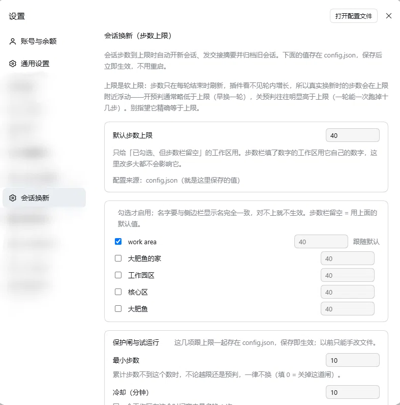

# dsh-session-rotate

[](https://github.com/cry-flu/dsh-session-rotate/actions/workflows/test.yml)
[](https://github.com/cry-flu/dsh-session-rotate/releases)
[](LICENSE)
[](package.json)
[](https://cry-flu.github.io/dsh-session-rotate/)

长会话越滚越贵。步数到上限时，本插件在**这一轮答完之后**（绝不中途打断）自动开一个新会话、把一份本地拼出来的交接摘要投过去、归档旧会话，然后把界面切到新会话。摘要不调用模型，是纯本地拼装，省下的是「手动总结 + 复制 + 新建会话 + 记住进度」这四步。

- 运行环境：DeepSeek Harness（DSH）桌面版 / Web GUI，作为 profile 插件挂载
- 不在 npm 上（`dsh-session-rotate` 这个包名已被另一位作者的同名插件占用，**不是本项目**）

## 功能

| 能力 | 说明 |
| --- | --- |
| 按工作区单独设上限 | 每个工作区一条 `maxSteps`；留空则跟随全局默认，且跟着默认一起变 |
| 模板拼接交接摘要 | 固定模板：头部 ≤16 行（最近用户消息 + 历史指令），后面**原样附上上一轮助手回复全文**（≤4000 字，超出头尾各留一段）。**不额外调用模型**。摘要只在新会话第一轮发一次，之后它作为上下文随每一步请求重发（缓存命中，单价极低） |
| 轮次预判 | 用最近 3 轮增量的均值估下一轮，在轮边界提前换，而不是等越限才换 |
| 保护闸 | `minSteps` 硬下限、`cooldownMinutes` 冷却、`maxRotations` 连续触发后暂停该工作区 |
| 试运行 | `dryRun` 只写日志，不建会话、不归档、不跳转 |
| 三个开关 | 自动归档（`archiveOnRotate`）、延迟归档（`deferArchiveMinutes`）、自动跳转（`autoSwitch`），外加「归档到点时自动跳到新会话」（`switchOnArchive`）。前三项可任意组合；关掉自动跳转时，归档要靠 `switchOnArchive` 到点先把界面切走才做，两者都关则旧会话一定保留 |
| 只动自己的会话 | 只归档本插件换出来的旧会话，ID 记在 `state.json` 的 `ownSessions`；不遍历、不批量、不碰其他会话 |
| 控制界面 | 设置页「会话换新」里改默认上限、保护闸、试运行与三个开关，保存即生效 |

## 安装

> **没有发布到 npm。** npm 上的同名包 `dsh-session-rotate` 与本项目无关（作者、仓库都对不上），不要用 `npm i dsh-session-rotate` 装。请按下面任一方式安装：`github:` 依赖、本地 `link:`，或手动放进 `node_modules`。

**1. profile 的 `package.json`：登记依赖和 bundle**（已 clone 到本地可用 `"link:<插件目录绝对路径>"` 或 `"file:<同上>"` 代替 `github:`）

```json
{
  "dependencies": { "dsh-session-rotate": "github:cry-flu/dsh-session-rotate" },
  "dsh": { "profile": { "bundles": ["...", "dsh-session-rotate"] } }
}
```

**2. 让 `node_modules` 里有这个名字** —— 在 profile 目录跑包管理器 install；手工建链接也行：

```powershell
cmd /c mklink /J "<profile>\node_modules\dsh-session-rotate" "<插件目录绝对路径>"
```

**3. profile 的 `cordis.patch.yml` 末尾挂载并配置**

```yaml
- insert:
    - id: dsh-session-rotate
      name: dsh-session-rotate
      config:
        defaultMaxSteps: 40
        workspaces:
          - name: my-workspace      # 与侧边栏显示名完全一致（空格、大小写都算）
            maxSteps: null          # null / 省略 / 0 / 空串 = 跟随 defaultMaxSteps
```

`workspaces` 默认为空数组 —— **空 = 所有工作区都不生效**，用哪个工作区就显式加哪一行。

**4. 整个 DSH 换进程重启一次。**「重开窗口」不会重载插件；重启后 Web GUI 端口会变，看启动日志里的新地址。

## 配置

配置文件 `~/.dsh/session-rotate/config.json`，设置页改的是同一份数据，保存即生效：

| 键 | 默认 | 说明 |
| --- | --- | --- |
| `defaultMaxSteps` | `40` | 默认步数上限 |
| `workspaces[]` | `[]` | `{ name, maxSteps }`；不在名单里的工作区不生效 |
| `minSteps` | `10` | 累计步数不到这个数就不换；`0` = 关掉这道闸 |
| `cooldownMinutes` | `10` | 同一工作区在该时间窗内最多换 1 次 |
| `maxRotations` | `3` | 在 `cooldown × maxRotations` 窗口里换满即暂停该工作区（状态存 `state.json`，重启不清零） |
| `dryRun` | `false` | 试运行开关 |
| `archiveOnRotate` | `true` | 换新时归档旧会话；设 `false` 则旧会话会留在侧边栏，请自行定期清理（上一轮正文仍会整段贴进交接摘要） |
| `deferArchiveMinutes` | `0` | 换新后旧会话先留多少分钟再归档，留的这段时间它在侧边栏里可直接点开看最后一条回复（默认视图不显示已归档会话）；`0` = 换新即归档（与 1.0.0 行为一致）；保留期内旧会话又被用到，会在那一轮结束时把整段保留期重新计一遍；到点时这个会话还有活在跑就往后顺 1 分钟（最多 10 次），见「已知限制」 |
| `autoSwitch` | `true` | 换新后是否把界面切到新会话；设 `false` 则仍然建新会话、投递交接摘要，但界面停在旧会话，新会话只出现在侧边栏。此时归档要看下一项：到点会先把你切到新会话再归档 |
| `switchOnArchive` | `true` | 只在 `autoSwitch=false` 且 `deferArchiveMinutes>0` 时起作用：到点先把界面切到新会话，再归档旧会话，免得你正看着的会话变成「暂时无法查看」。设 `false` 则界面既不会自动跳、旧会话也永不归档 |

`archiveOnRotate`（开/关）与 `deferArchiveMinutes`（分钟，`0` = 立即）可以任意组合。`autoSwitch` 关掉时：`deferArchiveMinutes>0` 且 `switchOnArchive=true` → 换新后旧会话先留在侧边栏，到点先切到新会话再归档；`switchOnArchive=false` 或分钟数为 `0` → 旧会话一定保留、不归档。关掉自动归档只影响本插件换出来的旧会话，其他会话一律不碰。

`maxSteps` 留空 = 跟随默认，之后改默认值它跟着变；填正整数就固定成那个数。工作区名必须与侧边栏显示名**完全一致**，对不上会静默跳过，实际匹配情况看 `debug.log`。

## 常用组合

四个开关容易绕晕，按「想要什么效果」反查最省事。默认值在**粗体**里：

| 想要的效果 | `autoSwitch` | `archiveOnRotate` | `deferArchiveMinutes` | `switchOnArchive` |
| --- | --- | --- | --- | --- |
| 默认：换新就跳到新会话，旧会话立刻归档（同 1.0.0） | **`true`** | **`true`** | **`0`** | 不生效 |
| 换新后不归档，旧会话留在侧边栏，自己定期清理 | **`true`** | `false` | 任意 | 不生效 |
| 不跳转，但 N 分钟后清理旧会话（到点前会先把界面切到新会话） | `false` | **`true`** | `N`（>0） | **`true`** |
| 完全不碰旧会话（界面也不跳） | `false` | 任意 | `0`，或 `switchOnArchive=false` | `false` |

哪几处会让某个开关「填了也不生效」：

- `switchOnArchive` 只在 `autoSwitch=false` **且** `deferArchiveMinutes>0` 时有意义；`autoSwitch=true` 时它不生效（设置页也不会显示这一项）。
- `autoSwitch=false` 时，`deferArchiveMinutes=0` 或 `switchOnArchive=false` 会让 `archiveOnRotate` 不生效 —— 旧会话一定保留，因为人还停在上面。
- `archiveOnRotate=false` 时，`deferArchiveMinutes` 不生效：没有「要归档」这件事，也就没有到点。
- 判定逻辑就在 `lib/index.js` 的 `archivePlan`（`lib/index.js:208-221`），上面四行是它的全部行为，没有隐藏分支。

## 用试运行测（dryRun）

想确认「到点会不会触发」，用它，不要靠改上限去真测：

1. 在 `workspaces` 里加上要测的工作区，`maxSteps` 填**你真实在用的值**（例如 40）；
2. 打开 `dryRun`（设置页开关，保存即生效，无需重启）；
3. 正常干活，跨过那个步数；
4. 看 `~/.dsh/session-rotate/debug.log`：命中会记一条 `[dry-run] 只记日志不换`（同一会话同一档步数只记一次，不会刷屏）。

**不要**把 `maxSteps` 调成 2、3 去真测：换新是真的换（新建会话、归档旧会话、界面跳走），一晚上能刷出一屏空会话。测完把 `dryRun` 关掉。

## 关闭与卸载

临时关闭：`workspaces` 改成 `[]`（或删掉配置），保存即生效。

彻底卸载：删掉 `cordis.patch.yml` 里那段 `- insert:`；从 profile 的 `package.json` 的 `dependencies` 和 `dsh.profile.bundles` 各删一行；删掉 `node_modules/dsh-session-rotate` 链接；重启 DSH。

```bash
rm -rf ~/.dsh/session-rotate      # 可选：连日志、暂停状态、增量历史一起删
```

## 已知限制

- **热重载无效。** 改插件代码（尤其 `lib/client.js`）后必须整个 DSH 换进程重启，「重开窗口」不算；重启后 Web GUI 端口会变。
- **上限是软上限。** 判定只发生在轮与轮之间，不打断进行中的轮，真实换新点会在 `maxSteps` 附近浮动：开预判通常略低，关预判往往明显偏高（一轮能跑掉二十几步）。
- **换新后的第一轮是一次真实请求。** 新会话把交接摘要作为第一条用户消息发出去，摘要本身零成本，但那一轮对话照常计费，会产生少量 token 费用。
- 只对顶层会话生效，子会话跳过；每个会话只触发一次；被暂停的工作区用 `POST /dsh-session-rotate/config` 带 `{"clearPause": true}` 恢复，或删 `~/.dsh/session-rotate/state.json` 后重启插件。
- **延迟归档到点会先把界面切走。** 走「不跳转 + N 分钟后清理」这条路时，到点由 `switchOnArchive` 先把界面切到新会话，`SWITCH_LEAD_MS`（3 秒，`lib/index.js:160`）之后才归档旧会话。如果那一刻你正在旧会话里打字，界面切走会把输入框一起带走 —— 没发出去的内容不会跟着过来。
- **保留期到点撞上正在跑的活：顺延，不掐断。** 到点先问宿主这个会话还有没有活在跑（`workspace/session-activity` 瀑布，`archiveDeferredOnce`），有就顺延 1 分钟再问，最多 10 次（`MAX_DEFERRALS`）；顺延用尽还有活就放弃归档、会话原样留在侧边栏，日志记一行「旧会话一直有活，放弃到点归档」。归档调用 `archiveSession(id)` **不带** `stopActivity`，宿主在这几毫秒里又判活跃会抛 `WorkspaceActiveSessionError`，插件接住继续顺延 —— 任何情况下都不会掐断正在跑的那一轮。代价是会话可能一直留着（最长约 10 分钟）；想马上清掉就等它闲下来手动归档。
- **1.2.0 时期排队的延迟归档，升级后不会被补上。** 归档前要过 `canTouchOwn` 这道闸（`lib/index.js:1038`），而 `ownSessions` 名单是 1.3.0 才有的：1.2.0 换出来的旧会话 id 从来没被记进那份名单，所以升级后到点只会记一行 `跳过归档：…不在本插件换出的会话名单里，未动它`，那条待办同时被丢掉、不会重试。这些会话需要你自己在侧边栏清理。
- **交接摘要是新会话的起步成本。** 上一轮回复全文（≤4000 字）会作为新会话第一条用户消息发出，之后随上下文每步重发；缓存命中后单价极低，但新会话的起步上下文确实比空会话大。

## 实测参考

2026-11-08 从平台导出的 `usage_data_*.zip`（`amount` / `cost` 两个 CSV）按日汇总。原始导出不入库（`usage-raw/` 已在 `.gitignore` 里），但**表里 10-31 与 11-07 两行是可以复算的**：`tools/usage-summary.ps1` 直接读 zip 或解压后的目录，口径与下表一致。

```powershell
pwsh -File tools\usage-summary.ps1 -Path E:\download\usage_data_2026-11-07_2026-11-07.zip
# | 2026-11-07 | 1,418 | 85,801,186 | 98.2% | 6.3266 | 60,509 | 0.446 |
```

口径：请求数 = `request_count` 求和；token 总量 = `input_cache_hit_tokens` + `input_cache_miss_tokens` + `output_tokens`；缓存命中率 = hit ÷ (hit + miss)；花费 = `cost` 列（CNY）求和；后两列由前四列除算。每天只算这几项：

| 日期 | 请求数 | token 总量（输入+输出） | 缓存命中率 | 花费（CNY） | 平均每次请求 token | 每 100 次请求花费（CNY） |
| --- | --- | --- | --- | --- | --- | --- |
| 2026-10-31 | 1,565 | 218,093,582 | 97.3% | 14.6912 | 139,357 | 0.939 |
| 2026-11-03 | 273 | 38,111,601 | 96.4% | 2.9166 | 139,603 | 1.068 |
| 2026-11-07 | 1,418 | 85,801,186 | 98.2% | 6.3266 | 60,509 | 0.446 |

`2026-10-31`、`2026-11-07` 两行已用 `tools/usage-summary.ps1` 对原始导出各重算一次，七列逐位一致（10-31：68 行 amount / 17 个小时段；11-07：64 行 amount / 16 个小时段）。`2026-11-03` 那天的导出没留，**这一行没有可核查的输入**，只能是当次记下的汇总。

一句话：平均每次请求 token 从 139,357（10-31）掉到 60,509（11-07），约 -57%；但这三天的请求量差着一个数量级（1,565 / 273 / 1,418），而且 11-07 跑的还是 1.1.x —— 这些数字是**观察到的现象**，不是「插件省了多少」的因果结论。

读这张表之前先看五条：

1. 单用户、单环境（Windows 桌面版 + `deepseek-flash`）的数据；三天工作量不同（请求数 1,565 / 273 / 1,418），**量不一样的日子不能直接横比**。
2. 同期还做了别的改动：停掉自动回复、归档长会话、加省 token 规则。下降不能全归功于本插件。
3. 11-03 并不能当「插件之前」：本机 `debug.log` 最早一条 `已加载` 是 `2026-11-03T16:03:47Z`，当天下午已有一次真实换新。真正的「插件之前」只有 10-31。
4. 11-07 当天插件版本是 0.2.1–1.0.0（`CHANGELOG` 里 1.1.0 记的是 2026-11-08），不是 1.4.1；1.2.0 之后的延迟归档、1.3.x 的跳转开关都没有体现在这两组数据里。
5. 11-03 的 CSV 里另有 4 次 `function_call` 计数，不是 token，未计入上表（那份导出同样没留，无法复核）。

**待补**（没有数据支撑，不估算）：11-08 全天数据（当天结束才导得出）；换新前后会话的平均上下文大小（现有导出没有会话维度）。

插件的直接证据（本机 `debug.log`，截至 `2026-11-08T03:20Z`）：累计换新 43 次（11-03 1 次、11-04 3 次、11-06 12 次、11-07 24 次、11-08 3 次），其中 `先留在列表里` 7 次、`已到点归档` 5 次。这只证明它在跑，不证明省了多少 token。

## 测试情况

只在我本人环境跑过，**没有**跨平台、跨版本验证：DSH 桌面版 `0.2.1-rc.3`（Windows）+ Node `v24.18.0`，`npm test` → 46 pass / 0 fail（`node --test`）。CI（`.github/workflows/test.yml`）会在 ubuntu + windows × node 20/22/24 上跑单测，但那只覆盖单测，不覆盖宿主行为。

## 声明

大部分代码由 AI 辅助生成，经人工审查与本地测试，但**不保证**在所有环境下行为如预期。请先小范围试用、确认没有副作用，再拿它处理重要会话。

## 控制界面



设置 → 会话换新。上半是**默认步数上限**（只对「已勾选、但步数栏留空」的工作区生效）；中间是**工作区名单**，勾选启用，步数栏填数字就用它自己的上限、留空则跟随默认；下半是**保护闸与试运行**：最小步数、冷却（分钟）、连续换新上限、「试运行（只记日志不换）」、「换新时归档旧会话」及其「归档前先留（分钟）」、「换新后自动跳到新会话」，以及只在关掉上一项时才出现的「归档到点时自动跳到新会话」（截图里这一项是勾着的，因为它上面那项被取消了）。最下面是「保存」「重新读取」和最近日志。

## License

[MIT](LICENSE)
